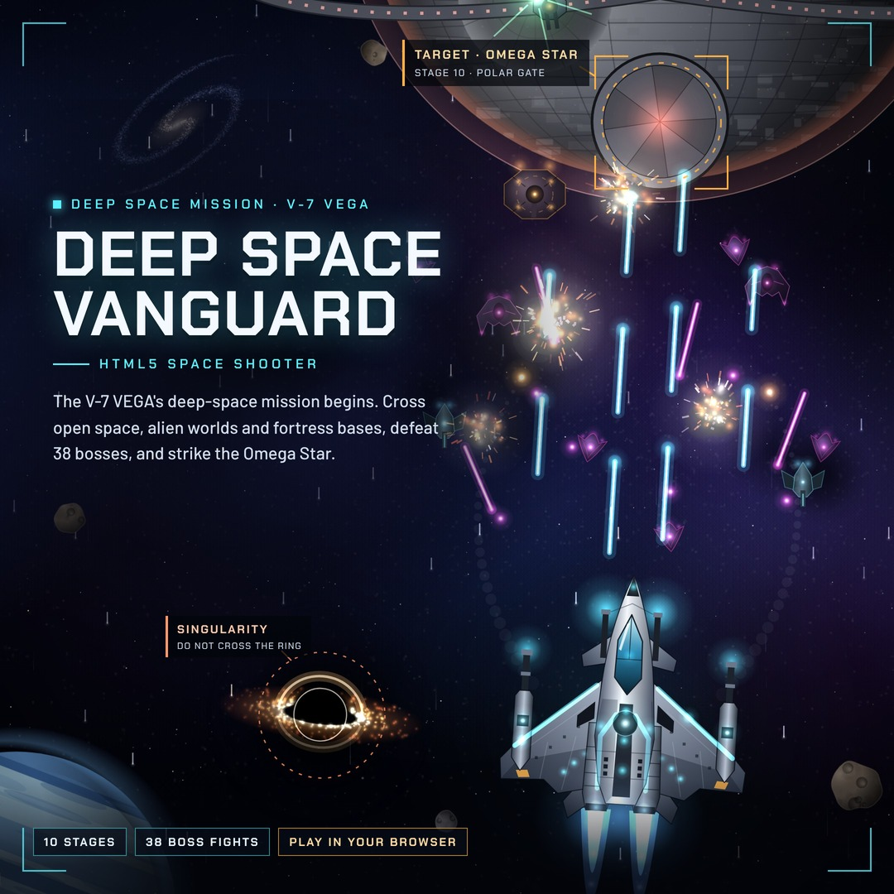

# 烬翼：弑光 · ASHWING: Slay the First Light

原名《深空先锋 · Deep Space Vanguard》。HTML5 Canvas 射击游戏，纵版与横版交替，支持键鼠和手机触屏。
当前版本 v0.1（测试版）；1.0 发行版正在开发中，计划见 Claude 文档《烬翼：弑光 1.0 开发计划》。

Formerly *Deep Space Vanguard*. An HTML5 canvas shooter that switches between vertical and horizontal flight,
playable with keyboard/mouse or touch. v0.1 is the public test build; 1.0 is in development.



## 构建 / Build

```bash
npm run build        # = node tools/build.mjs
npm test             # 构建 + 网站包冒烟测试（需要 Python Playwright）
npm run test:campaign  # 构建 + 机器人跑完 101 个扇区（开无敌，只验证流程）
```

| 产物 | 用途 |
|---|---|
| `dist/claude/ashwing.html` | 单文件版，即 Claude 里发布的版本 |
| `dist/web/` | 网站发布包，把这个文件夹的内容整体上传即可（部署见 `docs/部署说明.md`） |

本地试玩：`python3 -m http.server -d dist/web 8000`，打开 http://localhost:8000 。

## 源码结构 / Source layout

脚本按系统拆成 71 个文件，`src/manifest.json` 记录加载顺序；构建时按顺序拼成一个普通 `<script>`，所有文件共享同一个顶层作用域，和原来的单文件完全一样。新增文件时必须加进 manifest，并注意顺序。

| 路径 | 内容 |
|---|---|
| `src/shell/` | 页面头部、界面 HTML、结尾 |
| `src/style.css` | 全部样式 |
| `src/js/core/` | 语言、存储、游戏状态、主循环、更新、渲染、输入 |
| `src/js/audio/` | 音效与程序生成音乐 |
| `src/js/world/` | 背景、星空、扇区、关卡切换、黑洞、自适应飞行速度 |
| `src/js/player/` | 玩家武器、操作、V-7 VEGA 绘制、超级武器 |
| `src/js/combat/` | 击毁、敌方弹幕、光束、Boss 部件、特效 |
| `src/js/enemies/` | 刷怪与各主题的普通敌人 |
| `src/js/stages/` | 地表与基地关卡的地形和绘制 |
| `src/js/bosses/` | 38 个 Boss 与终章 |
| `src/js/ui/` | HUD、首页、新手指引、开发者模式、排行榜、界面 |
| `assets/web/` | 网站版字体、图标、分享图、标题与描述（`meta.json`） |
| `tools/` | 构建脚本、中文字体子集工具 |
| `tests/` | 冒烟测试、全流程机器人 |
| `promo/` | 封面与宣传图 |
| `docs/` | 部署说明、v0.1 评估 |

新增中文文字后，`npm run build` 会提示字体子集缺字，运行 `python3 tools/subset_fonts.py` 即可。

## 操作 / Controls

| 操作 | 键盘 | 触屏 |
|---|---|---|
| 移动 Move | WASD / 方向键 / 鼠标拖动 | 拖动 |
| 射击 Fire | 默认自动射击；空格手动射击，F 开关自动 | 自动 |
| 追踪导弹 Homing missiles | Shift / X / 鼠标右键 | 导弹按钮 |
| 切换武器 Spread / Beam | Q / 1 / 2 | 武器按钮 |
| 全屏爆炸 Nova（每 10 个 M 充能一次） | E | 爆炸按钮 |
| 暂停 · 静音 · 音乐 | P · M · N | 暂停按钮 |

每收集 10 个 W 自动发动 Starbreaker 超级武器 10 秒。

## 版本 / Version

见 [CHANGELOG.md](CHANGELOG.md)。

## 授权 / License

All rights reserved. 游戏代码与美术未开源，未经许可不得复制或再发布。
字体为 SIL Open Font License 1.1，授权文件在 `assets/web/fonts/`。
